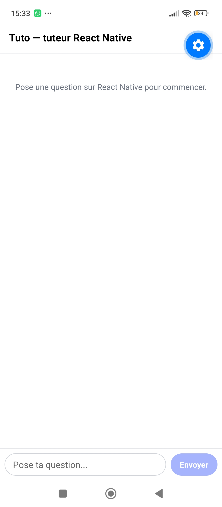
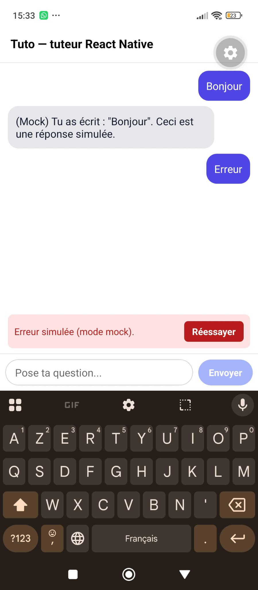
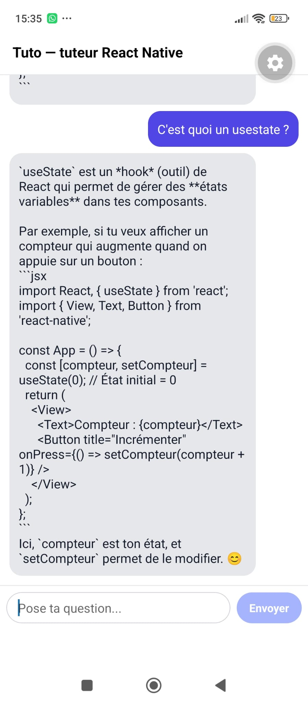
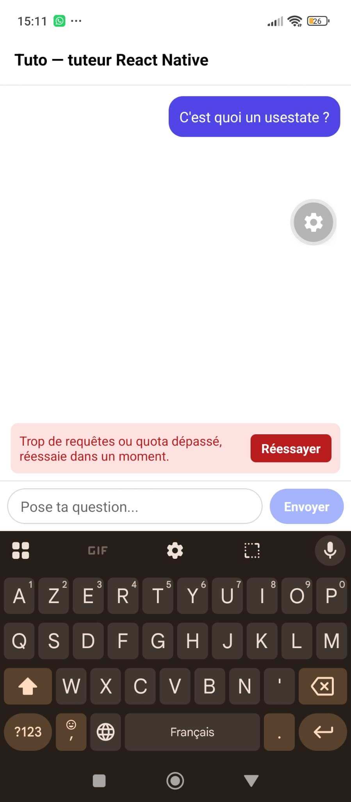

# Tuto — Chat IA React Native

Application mobile (Expo / React Native) à écran unique pour discuter avec **Tuto**, un assistant IA qui joue le rôle de tuteur pour les débutants en React Native.
L'IA utilisée est **Mistral** (modèle `ministral-8b-latest`), appelée via son API HTTP.
Un **mode mock** permet de tester l'application sans clé API.

## Captures d'écran

| Accueil | Mode mock + erreur simulée | Réponse de Mistral | Erreur API (429) |
|---|---|---|---|
|  |  |  |  |

> La roue dentée visible en haut à droite n'appartient pas à l'application : c'est le bouton d'outils de développement d'Expo Go.

## Installation et lancement

Prérequis : Node.js (LTS), npm et l'application **Expo Go** sur un téléphone (Android ou iOS).

```bash
git clone https://github.com/BasmaMORABIT/rn-ia-projet1-chat.git
cd rn-ia-projet1-chat
npm install
copy .env.example .env      # macOS / Linux : cp .env.example .env
npx expo start
```

Scanner ensuite le QR code avec Expo Go (Android : bouton « Scan QR code » dans Expo Go ; iOS : appareil photo).

En cas de problème de connexion entre le téléphone et l'ordinateur (réseau d'école, pare-feu) :

```bash
npx expo start --tunnel
```

Si l'écran ne correspond pas au code : appuyer sur `r` dans le terminal pour recharger l'application, ou relancer avec `npx expo start -c` pour vider le cache.

## Mode mock (tester sans clé API)

Le fichier `.env.example` est fourni avec `EXPO_PUBLIC_USE_MOCK=true` : après `copy .env.example .env`, l'application fonctionne directement en mode mock.

- Les réponses sont simulées (« (Mock) Tu as écrit : ... ») après un délai d'1 seconde, pour imiter le réseau.
- **Envoyer un message contenant le mot « erreur »** déclenche une erreur simulée, ce qui permet de tester le bandeau d'erreur et le bouton « Réessayer ».
- Le reste de l'application est identique : seule la source de la réponse change (voir `src/services/ai.js`).

## Utiliser la vraie IA (Mistral)

1. Créer un compte sur [console.mistral.ai](https://console.mistral.ai), puis une clé API.
2. Dans le fichier `.env` (jamais commité) :
   ```env
   EXPO_PUBLIC_AI_API_KEY=votre_cle
   EXPO_PUBLIC_AI_MODEL=ministral-8b-latest
   EXPO_PUBLIC_USE_MOCK=false
   ```
3. **Relancer le serveur** (`Ctrl+C` puis `npx expo start -c`) : le `.env` n'est lu qu'au démarrage.

## IA utilisée et pourquoi

- **Fournisseur : Mistral AI.** Offre gratuite pour l'expérimentation, fournisseur européen, API simple (format « chat completions » : une liste de messages `system` / `user` / `assistant`).
- **Modèle : `ministral-8b-latest`.** Modèle léger, suffisant pour des réponses courtes de tuteur (5 phrases maximum selon le prompt système).
- **Pourquoi pas `mistral-small-latest` ?** C'était le premier choix, mais il renvoyait systématiquement une erreur **429 « Rate limit exceeded »** avec l'offre gratuite. Un test direct de l'API a montré que la clé était valide et que la limite concernait ce modèle uniquement.

## Architecture

```
App.js                      → écran de chat : composant conteneur (gère tout le state)
src/
  components/               → composants de présentation (sans state, tout passe par les props)
    MessageBubble.js        → une bulle de message (utilisateur à droite, IA à gauche)
    ChatInput.js            → champ de saisie + bouton Envoyer
    ErrorBanner.js          → message d'erreur + bouton Réessayer
  services/
    ai.js                   → appel à l'API Mistral (fetch) + mode mock + gestion des erreurs
    prompts.js              → prompt système (centralisé, pas dans les composants)
.env.example                → variables d'environnement à copier dans .env (sans secret)
```

**Flux d'un message :** `ChatInput` → `handleSend` (App.js) ajoute le message de l'utilisateur au state → `askAI(history)` → `sendMessage(history)` (ai.js) envoie le prompt système + tout l'historique à Mistral → la réponse est ajoutée au state → la `FlatList` se met à jour et défile jusqu'en bas.
En cas d'erreur : `ai.js` lève une erreur avec un message lisible → `App.js` la stocke dans le state `error` → `ErrorBanner` s'affiche → « Réessayer » relance `askAI` avec le même historique.

## Fonctionnalités

- [x] Écran de chat avec bulles utilisateur / IA visuellement différentes
- [x] Champ de saisie + bouton « Envoyer » désactivé si le champ est vide (ou pendant une réponse)
- [x] Appel à l'API avec `fetch` dans un fichier séparé (`src/services/ai.js`)
- [x] Prompt système : rôle de tuteur React Native, réponses courtes, recentrage si hors sujet
- [x] Indicateur de chargement pendant la réponse
- [x] Erreurs visibles (pas de réseau, clé invalide 401, quota 429, réponse vide) avec bouton « Réessayer »
- [x] Le clavier ne masque pas le champ (`KeyboardAvoidingView`) et la liste défile automatiquement vers le dernier message
- [x] Mode mock fonctionnel, avec erreur déclenchable
- [x] Bonus : historique envoyé au modèle (l'IA garde le contexte de la conversation)
- [ ] Bonus : bouton « Nouvelle conversation »
- [ ] Bonus : réponse en streaming

## Limites connues

- **Clé API embarquée dans l'application** : les variables `EXPO_PUBLIC_*` sont incluses dans le code de l'app. C'est acceptable pour un exercice, jamais en production : il faudrait un serveur intermédiaire (proxy) qui garde la clé.
- **Conversation non sauvegardée** : elle est perdue à la fermeture de l'application.
- **Coût croissant** : tout l'historique est renvoyé à chaque message, donc le nombre de tokens augmente avec la longueur de la conversation.
- **Offre gratuite Mistral** : des erreurs 429 (limite de requêtes) restent possibles ; elles sont affichées avec le bouton « Réessayer ».

## Auteur

Basma Morabit
